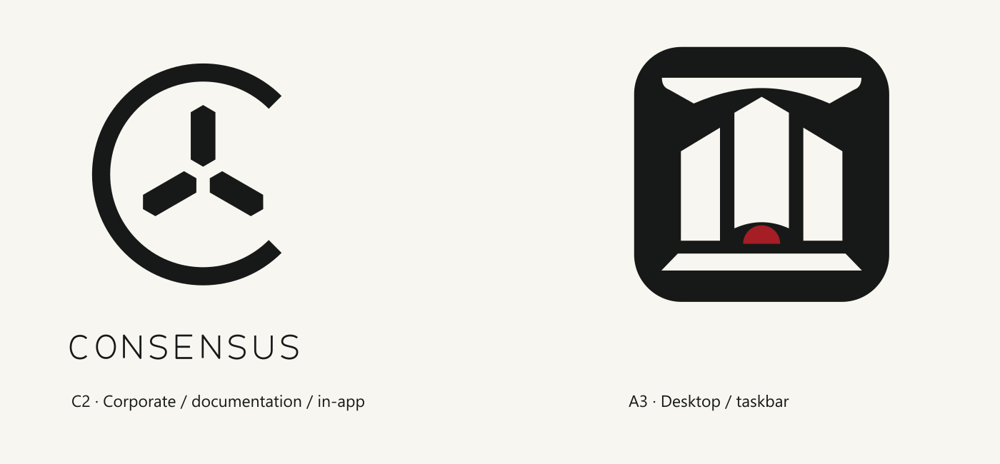

# CONSENSUS branding

<picture>
  <source media="(prefers-color-scheme: dark)" srcset="../static/branding/consensus-c2-lockup-light.svg">
  
</picture>

Approved identity split, 2026-10-09:

| Use | Identity | Asset |
| --- | --- | --- |
| Corporate identity, documentation, internal information | C2 | `static/branding/consensus-c2-lockup-dark.svg` |
| Symbol-only program branding | C2 | `static/branding/consensus-c2-symbol-dark.svg` |
| Dark surfaces | C2 | Corresponding `-light.svg` or `-light.png` |
| Desktop, executable, shortcut and taskbar icons | A3 | `static/icons/consensus_icon.ico` |
| Desktop icon vector master | A3 | `static/branding/consensus-a3-desktop.svg` |

C2 is the open C with three independent inward-facing monoliths. It is the
corporate and program logo. A3 is the capped tribunal with three pillars, one
plinth and a red semicircle; use it only for operating-system icons.

SVG masters have transparent backgrounds and scale without pixelation. The
corporate wordmark uses outlined strokes and needs no installed font. Transparent
PNG companions are provided for software that does not accept SVG.

The program displays C2 in its shared status masthead across all themes. EXCOMM
(the military theme) keeps its original EXALT artwork in the large header
illustration and console boot. All themed illustrations retain their theme
identity separately from the corporate mark. Theme colors remain intact.

User correction, 2026-10-09: corporate branding must not replace the EXALT theme
artwork. C2 remains the shared program masthead and documentation identity;
A3 remains the desktop and taskbar icon.

The Windows icon contains A3 on a dark rounded tile, with no small text. The ICO
contains multiple sizes for Windows, and its PNG companions retain the existing
64-pixel and 256-pixel application contracts. Packaging embeds the same ICO used
by the Flet window. C2 is never used as the taskbar icon.

Keep the shapes, proportions, clear gaps and restrained red accent intact. Use
the dark C2 mark on light backgrounds and the light mark on dark backgrounds.

